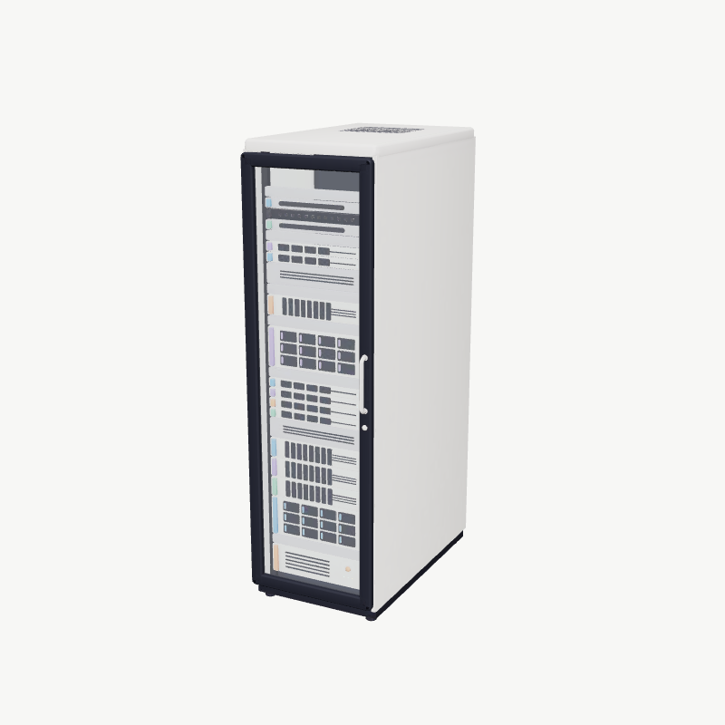
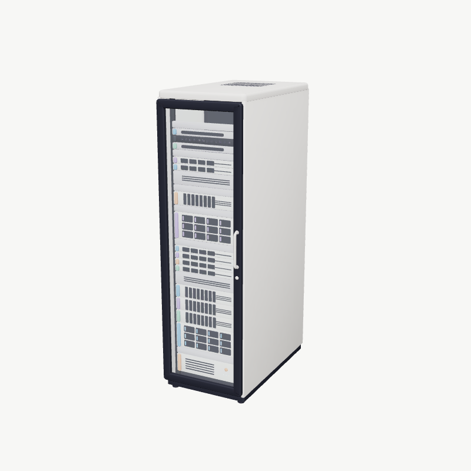
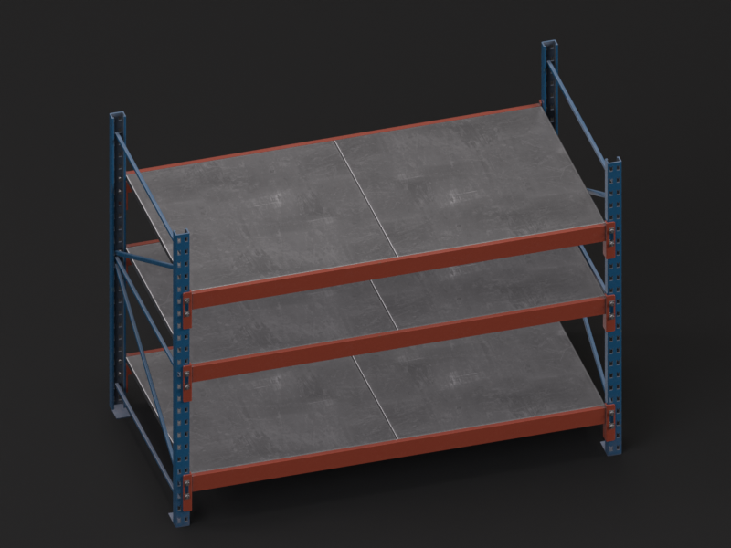
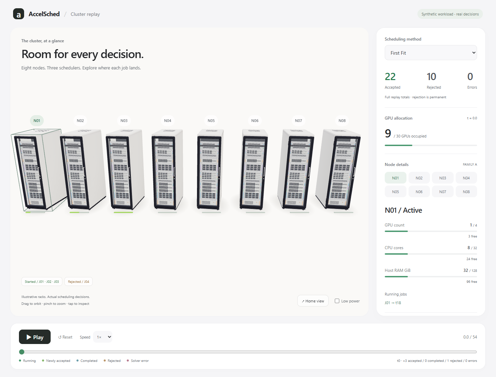
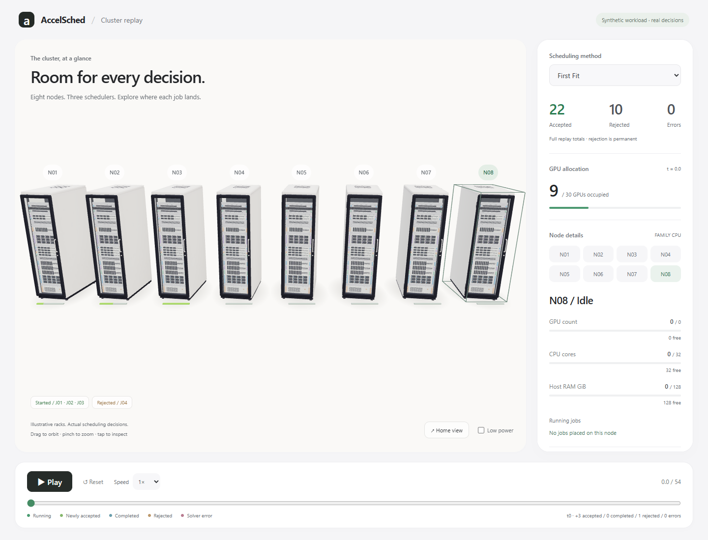
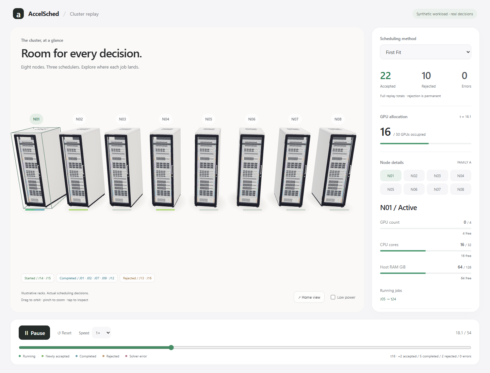

# Architect design revision R2

Implements [R2](https://github.com/JohnnyZPiggy/AccelSched/pull/119#issuecomment-6525382110)
on the existing branch/Draft PR, starting from `c9035c379c1d7923bf5144b4ac877cb04c63439c`.
No merge or public deployment. All Python, replay JSON, schema/state helper and
dependencies remain unchanged. The imported rack is illustrative art, not GPU hardware
or telemetry. No scheduling claims were added.

## Source-first asset comparison

Compared rendered Grab3D full/light models and NVIDIA's supplied rack thumbnail.
License/manifest files were downloaded and read, rather than relying on page labels.
The GLB was decoded to audit triangles, bounds, texture dimensions and byte counts.
See [machine-readable GLB audit](assets/glb-audit.json) and
[NVIDIA metadata audit](assets/nvidia-audit.json).

| Option | License proof | Measured / estimated mobile cost | Decision |
| --- | --- | --- | --- |
| [Grab3D light](https://grab3d.com/dl/server-rack/server-rack-light.glb) | Original CC0 [LICENSE](../public/assets/server-rack/LICENSE.txt) and [manifest](../public/assets/server-rack/manifest.json) | 977,100 bytes; 14,851 source triangles; 4×1024² textures; ~21.3 MiB estimated RGBA+mips; ~0.68 MiB geometry arrays | **Chosen**: visually close to full, much smaller decode/render cost |
| [Grab3D full](https://grab3d.com/dl/server-rack/server-rack.glb) | Same publisher's CC0 license and manifest | 1,965,504 bytes; 27,252 triangles; 6×2048² textures; ~128 MiB estimated RGBA+mips; ~1.03 MiB geometry | Inspected, not bundled: detail difference small at overview scale |
| [NVIDIA SimReady rack_large_empty_a02](https://huggingface.co/datasets/nvidia/simready-assets/tree/main/rack_large_empty_a02) | Per-asset [CC-BY-4.0 LICENSE](assets/nvidia-LICENSE.txt) and [packaging metadata](assets/nvidia-packaging.json) | USD geometry + primary textures total 25,473,140 bytes before conversion, excluding duplicated source assets; browser-ready triangles/memory NOT_MEASURED | Supplied preview is warehouse shelving, not a server cabinet; skip USD conversion |

Texture figures are estimates assuming RGBA8 plus a full mip chain, **not measured
VRAM**. Geometry/textures are shared by all eight clones, not loaded eight times.
The full model is only an ignored local audit download; runtime ships the light
file unchanged. NVIDIA preview attribution is in the [asset credits](../public/ASSET_CREDITS.md).
No vendor model/product identity or endorsement is claimed.

Enumerated the SimReady root directory metadata (2,679 entries): rack entries are
primarily warehouse/storage assets; no server-named entry appeared in that listing.
Also inspected NVIDIA's [Data Center pack overview](https://docs.omniverse.nvidia.com/usd/latest/usd_content_samples/downloadable_packs.html#data-center-assets-pack),
which lists 33 models and 9.8 GB. **Did not download** that pack or claim its terms
from the unrelated Hugging Face dataset. Only one NVIDIA thumbnail, license and
packaging metadata were downloaded. The small procedural fallback is retained for
asset failures, not used as the primary presentation.

Static previews (light/full captured locally using the same studio setup):

Audit reproduction, from the demo directory with the local dev server running:
`node tools/audit-rack.mjs`. It fetches the full GLB only if absent, capped at 2 MB,
into ignored `test-results/`; it never downloads an NVIDIA pack. Playwright may
clean that scratch directory during a test run. License/manifest provenance and
the integrated file's SHA-256 are recorded in [credits](../public/ASSET_CREDITS.md).

## Interface and rendering

Warm-white studio canvas; graphite system typography; compact header; rounded
surfaces, subtle separators/elevation; green reserved mainly for allocations and
selection. No proprietary fonts, copied Apple artwork, sci-fi grid or pedestal.
[Apple's HIG](https://developer.apple.com/design/human-interface-guidelines/) informed
general hierarchy and affordances, not a copied page design.

The GLB is fetched once through GLTFLoader, cloned with shared geometry/materials,
normalized and framed using its measured bounds. Static decorative source LEDs
are hidden; mathematical resource segments, hit targets, IDs and selection
outlines remain outside the art. Soft radial contact-shadow planes are local visual
aids, **not ray-traced shadows**. No new dependency, external decoder, HDRI or CDN.

Desktop shows all eight separately pickable models. A 390px phone view uses an
eight-node overview plus a large selected-rack view within the **same WebGL canvas**,
sharing the same model, scene and GPU resources. Orbit/zoom affects both views;
Home restores an intentional first view. Low-power/reduced-motion settings and
the real-data inspector survive unavailable WebGL or model loading failures.

## Build / browser / preview evidence

- `npm run build`: PASS. ~607 kB JS / 156 kB gzip including GLTFLoader, ~9 kB CSS,
  977 kB GLB plus ~46 kB replay JSON. Existing Vite >500 kB advisory retained.
- `npm test`: PASS, **5 focused Edge tests in 13.3 s**. The four existing cases remain,
  plus a model-load-failure fallback case. Logs: [build](build.txt), [browser](browser-tests.txt).
- Desktop 1440×1080 and phone 390×844: every rack independently picked in default
  overview; labels visible/non-overlapping initially and after Home; only **one GLB
  request** per page. Methods, accepted/rejected/error counts, timeline both ways,
  pause/reset, speed/touch, final release, reduced motion and fallback pass.
- No console/page errors or external requests in the normal viewport runs. Per-run
  animation callback intervals are retained in `browser-*.json`; they are not GPU
  FPS or physical-phone performance claims.
- HTTPS verification: `node tools/verify-mobile.mjs`, [result](mobile-https.json),
  [screenshot](mobile-https.png). Valid certificate; actual asset SHA, canvas,
  eight labels, touch, methods and playback checked. Physical iPhone Safari **NOT_RUN**.
- Existing Tailscale [routes](tailscale-status.txt) preserved: 443→5173,
  8443→5174, tailnet only. No Funnel or Pages. Vite still uses loopback and the
  exact allowed hostname.

Scope check: `git diff --exit-code c9035c3 -- '*.py'
demos/accelsched-3d/public/data/replay.json demos/accelsched-3d/src/replay.ts
pyproject.toml demos/accelsched-3d/package.json demos/accelsched-3d/package-lock.json`
returned 0 with no diff. Existing Python tests were not rerun for this visual-only
pass; their original 56-pass evidence remains historical. `git diff --check` passes.

Local: **http://127.0.0.1:5174/**

Private mobile: **https://laptop-dv0lktef.tail9ceb46.ts.net:8443/**

## Before / after review

Before R2: [desktop](before-r2-desktop.png), [phone](before-r2-mobile.png).
Reviewed the following actual screenshots after fixing the selection-outline
transform and refining small-label contrast. First-view composition is restored
with Home, not captured at an arbitrary orbit angle.

