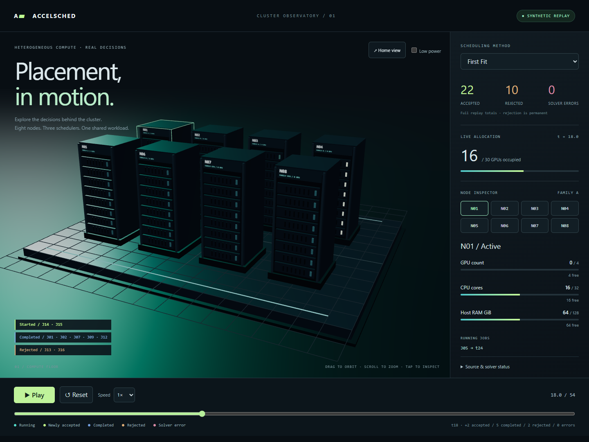
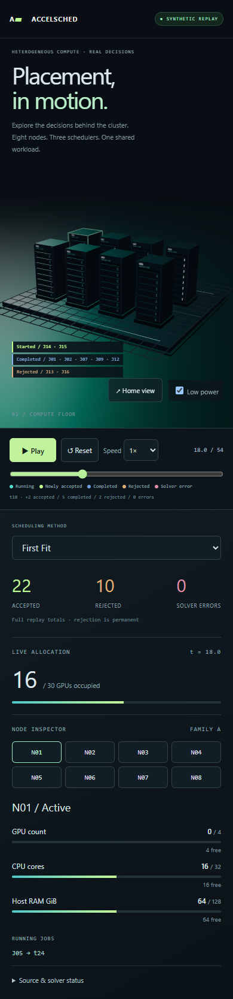

# Issue #118 verification

Date: 2026-10-30 (Europe/Zurich). Isolated branch:
`sae/issue-118-3d-cluster-replay`. Refreshed base main:
`9dc0c263d2aefeb151d565166b6b950e2ac9f6a5`.
Delivery commit is recorded in the Draft PR. Export source revision and dirty flag
are embedded in `public/data/replay.json`; the final export was regenerated from
a clean implementation commit, so the provenance includes the exporter itself.

| Gate | Result | Evidence |
| --- | --- | --- |
| Real engine export | PASS | seed 11; 2 s; first_fit / classic_best_fit / pgfp; 8 nodes, 32 jobs, 10 events per method |
| Independent source-to-state check | PASS | Every event: exact running IDs/ends, summed demands, eligibility, capacity, used+free, releases before arrivals, statuses/nulls, batch placement, counts |
| Fresh vs saved source report | PASS | All decisions/events/counts and batch fields except actual measured solve times match |
| Negative checker / solver-error paths | PASS | Corrupted ledger rejected; test-only injected engine solver failures stay errors, never rejections/running |
| Python tests | PASS | `python -m pytest -q tests/test_3d_replay.py tests/test_rolling.py`: **56 passed** |
| Build | PASS | `npm run build`: TypeScript + Vite static production build |
| Browser | PASS | `npm test`: **4 passed**, installed headless Microsoft Edge |
| Desktop + mobile layout | PASS | 1440×1080 and 390×844; screenshots inspected; no horizontal overflow |
| Interaction | PASS | Method switching, scrub both ways, node button and raycast selection, orbit/zoom, speed, pause/reset, touch taps, final release |
| Errors / network | PASS | No console errors, page errors or external runtime requests on both primary viewport runs |
| Reduced motion / WebGL loss | PASS | Low-power checked, paused start; usable inspector when WebGL context creation fails |
| Physical phone / Safari / Firefox | NOT_RUN | Desktop Edge touch emulation only; no real-phone FPS or battery claim |
| GPU experiments / backend | NOT_RUN | Not needed: CPU scheduler export and static browser only |

## Commands and measurements

From repository root (existing Python environment with NumPy/SciPy/pytest):

```powershell
python tools/export_3d_replay.py
python -m pytest -q tests/test_3d_replay.py tests/test_rolling.py
cd demos/accelsched-3d
npm ci
npm run build
npm test
npm run preview
```

The local Codex run used `../.sae-issue114/venv/Scripts/python.exe` from the checkout
root and the existing npm CLI fallback documented in README. No root dependencies
or production source were changed. No numerical benchmarks were run.

Fixture totals (honest outcomes; no guaranteed method ranking):

| Method | Accepted | Permanent rejection | Solver error |
| --- | ---: | ---: | ---: |
| first_fit | 22 | 10 | 0 |
| classic_best_fit | 25 | 7 | 0 |
| pgfp | 21 | 11 | 0 |

Vite build: ~510 kB JS / ~130 kB gzip; ~7.2 kB CSS / ~2.4 kB gzip; ~46 kB JSON.
Vite emits its standard >500 kB chunk advisory. This small single scene intentionally
keeps Three.js together; no model/texture/font downloads or runtime CDN dependencies.
The scene uses simple boxes, no shadows, postprocessing or expensive model assets.

`browser-1440.json` and `browser-390.json` contain 60 actual animation callback
intervals sampled during playback. These measure browser callback cadence on this
desktop, **not rendered GPU FPS or physical-phone performance**. Low-power mode
deliberately limits scene rendering to 30 Hz independently of these callbacks.
Interactions were responsive in the tested browser; real-phone smoothness remains
an Architect/Scientist follow-up check.

## Visual review

Reviewed both screenshots after fixing the initial mobile camera crop and text
overlap. Dark metallic rack fronts, restrained cyan/lime status LEDs, teal rim
lighting, floor seams, explicit node labels, event tray and numeric allocation
inspector are visible. Phone layout fits the full cluster and places controls
between the scene and inspector. Source/status caveats are expandable. All rack
geometry is procedural and cosmetic; CPU-only jobs do not imply GPU use.




Local preview: **http://127.0.0.1:5174/**. Port 5173 and Tailscale configuration
were left intact; no Pages deployment or public/phone route was created.
